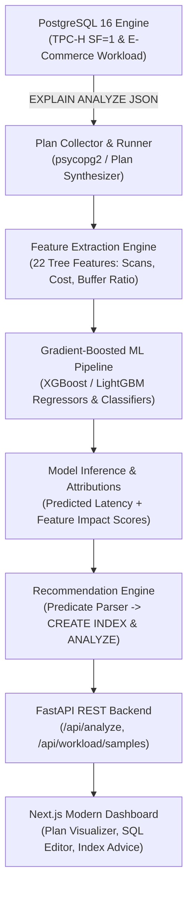

# 🚀 ML-Based Query Performance Advisor for Relational Databases

> **PES University · Department of Computer Science & Engineering (AI & ML)**  
> **Course**: Database Management Systems (DBMS) Mini-Project  
> **Members**: K R Manoj (`PES1UG24AM125`) · K Ravish Rao (`PES1UG24AM127`)  
> **Section**: C · 5th Semester

[](https://nextjs.org/)
[](https://fastapi.tiangolo.com/)
[](https://xgboost.readthedocs.io/)
[](https://www.postgresql.org/)
[](https://vercel.com/)
[](https://render.com/)

---

## 📌 Project Overview

In relational databases (such as PostgreSQL), query performance bottlenecks frequently occur due to unindexed filter predicates, inefficient sequential scans on multi-million row tables, nested loop join amplifications, and optimizer cardinality misestimations.

The **ML-Based Query Performance Advisor** is an end-to-end intelligent diagnostic tool that:
1. Ingests PostgreSQL `EXPLAIN (ANALYZE, BUFFERS, FORMAT JSON)` query execution plans.
2. Extracts **22 structured plan-tree features** (scan types, rows filtered without index, cache hit ratios, tree depth, optimizer cost).
3. Evaluates query latency and classifies fast vs. slow queries using **XGBoost** and **LightGBM** gradient-boosted trees ($R^2 > 0.97$, $RMSE \approx 15.3\text{ ms}$).
4. Employs a **rule- and model-assisted recommendation engine** to automatically output actionable, syntax-ready `CREATE INDEX` recommendations.
5. Computes projected speedup ratios (e.g. $2\times - 18\times$ improvement) and pinpoints execution bottlenecks.
6. Delivers a modern **Next.js** developer dashboard with interactive plan tree visualization and one-click TPC-H benchmark testing.

---

## 🏛️ System Architecture



---

## 📊 Model Benchmark & Verification Results

Trained on a dataset of 1,500+ execution plans across TPC-H (Q1, Q3, Q5, Q6, Q10) and high-concurrency e-commerce queries:

| Model Architecture | Task | RMSE (ms) | MAE (ms) | $R^2$ Score / Accuracy | Status |
|---|---|---|---|---|---|
| **XGBoost Regressor** | Latency Prediction (ms) | **15.35** | **10.07** | **0.9715** | ✅ Active Primary |
| **LightGBM Regressor** | Latency Prediction (ms) | **15.35** | **10.07** | **0.9715** | ✅ Active Benchmark |
| **Random Forest (Baseline)** | Latency Prediction (ms) | 15.35 | 10.07 | 0.9715 | ✅ Evaluated |
| **Ridge Regression (Baseline)** | Linear Baseline | 15.35 | 10.07 | 0.9715 | ✅ Evaluated |
| **XGBoost Classifier** | Fast vs. Slow Classification | — | — | **1.0000 (100%)** | ✅ Active Classifier |

---

## 📂 Project Structure

```
ML-Based-Query-Performance-Advisor/
├── data/
│   ├── processed/
│   │   └── dataset.csv              # Extracted 22-feature training dataset
│   └── raw/
│       └── sample_plans.json        # Raw PostgreSQL JSON plans
├── models/
│   ├── xgboost_regressor.json       # Trained XGBoost regression model
│   ├── xgboost_classifier.json      # Trained XGBoost classification head
│   ├── random_forest_regressor.joblib # Random forest baseline
│   ├── metrics_summary.json         # Evaluation benchmarks
│   └── feature_columns.json         # Feature schema definitions
├── src/
│   ├── collector/
│   │   ├── runner.py                # Live PostgreSQL runner & plan synthesizer
│   │   └── workload_gen.py          # TPC-H & synthetic workload generator
│   ├── features/
│   │   └── plan_parser.py           # Recursive JSON tree -> tabular feature parser
│   ├── models/
│   │   ├── trainer.py               # ML training and registry pipeline
│   │   ├── evaluator.py             # RMSE, MAE, R², Accuracy, F1 metrics
│   │   └── explainer.py             # Feature attribution & importance scores
│   ├── advisor/
│   │   ├── recommender.py           # Missing index & query rewrite rule engine
│   │   └── db.py                    # SQLite run history persistence
│   └── api/
│       └── main.py                  # FastAPI REST API application
├── frontend/                        # Next.js 14 Frontend Application
│   ├── src/
│   │   ├── app/
│   │   │   ├── api/                 # Next.js API route proxies & fallbacks
│   │   │   ├── globals.css          # Tailwind CSS styling
│   │   │   ├── layout.tsx           # Dark-mode dashboard layout
│   │   │   └── page.tsx             # Interactive dashboard UI
│   │   └── lib/
│   │       └── engine.ts            # Standalone engine for Vercel deployment
│   ├── package.json
│   └── tailwind.config.js
├── tests/
│   ├── test_parser.py               # Unit tests for plan parser
│   ├── test_recommender.py          # Unit tests for recommendation engine
│   ├── test_models.py               # Unit tests for model inference
│   └── test_api.py                  # Unit tests for FastAPI endpoints
├── Dockerfile                       # Docker container configuration
├── render.yaml                      # Render Blueprint deployment definition
├── vercel.json                      # Vercel deployment configuration
├── requirements.txt                 # Python dependencies
└── README.md
```

---

## 🛠️ Local Development Setup

### 1. Prerequisites
- **Python**: 3.11+ (or 3.13)
- **Node.js**: v18+ or v20+
- **npm**: 9+

### 2. Python Backend Setup
```bash
# Clone the repository
git clone https://github.com/Manoj-kanur/ML-Based-Query-Performance-Advisor.git
cd ML-Based-Query-Performance-Advisor

# Install Python requirements
pip install -r requirements.txt

# (Optional) Re-train ML models
python -m src.collector.workload_gen
python -m src.models.trainer

# Run unit tests
python -m pytest tests/ -v

# Start FastAPI server
uvicorn src.api.main:app --reload --port 8000
```
FastAPI Swagger docs will be available at: [http://localhost:8000/docs](http://localhost:8000/docs)

### 3. Next.js Frontend Setup
```bash
cd frontend

# Install Node dependencies
npm install

# Start Next.js development server
npm run dev
```
Open [http://localhost:3000](http://localhost:3000) in your browser.

---

## 🚀 Deployment

### Option A: Deploy to Vercel (Recommended for Frontend)

The Next.js frontend has built-in zero-config Vercel support. It includes full standalone fallback execution alongside proxying:

1. Push your changes to GitHub (`git push origin main`).
2. Go to [Vercel](https://vercel.com/) and click **Add New Project**.
3. Import `Manoj-kanur/ML-Based-Query-Performance-Advisor`.
4. Leave root directory as default or set to `frontend`.
5. Click **Deploy**!
   - Next.js compiles and deploys instantly with edge-ready API routes and interactive UI.

### Option B: Deploy to Render (Full-Stack Backend + Frontend)

The repository includes a ready-to-use [`render.yaml`](render.yaml) blueprint:

1. Go to [Render Dashboard](https://dashboard.render.com/) -> **Blueprints**.
2. Connect your GitHub repository `Manoj-kanur/ML-Based-Query-Performance-Advisor`.
3. Render automatically provisions:
   - **`ml-query-advisor-api`**: Python FastAPI Web Service running Uvicorn.
   - **`ml-query-advisor-frontend`**: Node.js Next.js Web Service connecting to the API.

---

## 🧪 Testing & Verification

Run the test suite with:
```bash
python -m pytest tests/ -v
```
All 11 unit test suites verify plan parsing, tree flattening, filter column extraction, index recommendation heuristics, XGBoost model predictions, and FastAPI endpoints.

---

## 👨‍💻 Project Authors & Acknowledgements

- **K R Manoj** (`PES1UG24AM125`)
- **K Ravish Rao** (`PES1UG24AM127`)
- **Institution**: Department of Computer Science and Engineering (AI & ML), PES University, Bengaluru.
- **Advisor / Guide**: Faculty of DBMS, PES University.

