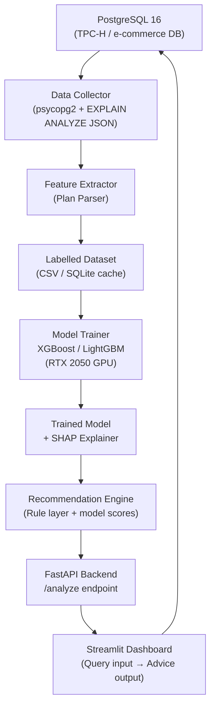
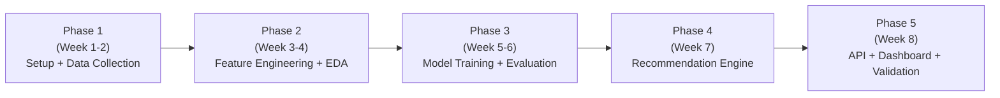

# ML-Based Query Performance Advisor — Implementation Plan

> **Project**: AM125 & AM127 · DBMS Mini-Project · PES University (AI & ML)
> **Members**: K R Manoj (AM125) · K Ravish Rao (AM127)

---

## Goal Description

Build an **end-to-end ML-Based Query Performance Advisor** for PostgreSQL that:
1. Collects and parses `EXPLAIN ANALYZE` JSON plan trees into structured features
2. Trains gradient-boosted tree models (XGBoost / LightGBM) to predict query execution time / classify fast vs. slow
3. Runs a rule-assisted recommendation engine that outputs `CREATE INDEX` suggestions
4. Validates speedup by re-running queries after index application
5. Presents everything through a **Streamlit** dashboard

---

## ✅ RTX 2050 — GPU Training Feasibility Verdict

| Property | Value |
|---|---|
| Architecture | Ampere (GA107) — same gen as RTX 3050 |
| CUDA Cores | 2,048 |
| Tensor Cores | 64 (INT4/INT8 mixed-precision) |
| VRAM | **4 GB GDDR6** (64-bit bus) |
| Memory Bandwidth | 112 GB/s |
| TGP | 30–45 W |
| CUDA Support | ✅ Yes |

### Verdict: ✅ YES — Training will work smoothly for this project

The dataset for this project (parsed `EXPLAIN ANALYZE` output → tabular features) will realistically be **5,000–50,000 rows × ~30 features**. This easily fits within 4 GB VRAM.

| Model | GPU Mode | Expected Fit in 4 GB VRAM? | Notes |
|---|---|---|---|
| XGBoost | `tree_method="hist"`, `device="cuda"` | ✅ Yes | GPU histogram training, fast |
| LightGBM | `device="gpu"` | ✅ Yes | CUDA native in v4+ |
| Random Forest (baseline) | CPU only | ✅ N/A | scikit-learn, no GPU needed |
| Linear Regression (baseline) | CPU only | ✅ N/A | Fits in RAM easily |

> [!NOTE]
> Deep Neural Networks are **not needed** for this project. XGBoost/LightGBM on tabular plan features is the gold standard — the RTX 2050's VRAM constraint is irrelevant here.

> [!TIP]
> Enable GPU for XGBoost with: `xgb.XGBRegressor(tree_method="hist", device="cuda")`. For LightGBM: `lgb.train({"device": "gpu"}, ...)`. Both will use the RTX 2050 without any config changes beyond these flags.

---

## Proposed Tech Stack

```
┌─────────────────────────────────────────────────────────┐
│                     Tech Stack                          │
├──────────────────┬──────────────────────────────────────┤
│ Layer            │ Technology                           │
├──────────────────┼──────────────────────────────────────┤
│ Database         │ PostgreSQL 16 + pg_stat_statements   │
│ Workload         │ TPC-H benchmark (scaled-down, SF=1)  │
│ Data Collection  │ Python 3.11, psycopg2, subprocess    │
│ Feature Eng.     │ pandas, numpy, json (stdlib)         │
│ ML Training      │ scikit-learn, XGBoost, LightGBM      │
│ Model Explain.   │ SHAP                                 │
│ Recommendation   │ Custom rule engine (Python)          │
│ Backend API      │ FastAPI + Uvicorn                    │
│ Frontend / UI    │ Use Angular/Next js
                            │
│ DB ORM           │ SQLAlchemy (metadata only)           │
│ Versioning       │ Git + GitHub                         │
│ Experiment Track │ MLflow (optional but recommended)    │
│ GPU Acceleration │ CUDA 12.x (RTX 2050 / Ampere)       │
└──────────────────┴──────────────────────────────────────┘
```

---

## System Architecture



---

## Proposed Changes

### Component 1 — Project Scaffolding

```
Mini-Project/
├── data/
│   ├── raw/              # EXPLAIN ANALYZE JSON dumps
│   ├── processed/        # feature CSV files
│   └── workload/         # TPC-H SQL query files
├── src/
│   ├── collector/
│   │   ├── __init__.py
│   │   ├── runner.py        # runs queries, captures EXPLAIN ANALYZE
│   │   └── workload_gen.py  # TPC-H / synthetic query generator
│   ├── features/
│   │   ├── __init__.py
│   │   └── plan_parser.py   # JSON plan tree → tabular features
│   ├── models/
│   │   ├── __init__.py
│   │   ├── trainer.py       # train XGBoost, LightGBM, baselines
│   │   ├── evaluator.py     # RMSE, R², classification metrics
│   │   └── explainer.py     # SHAP feature importance
│   ├── advisor/
│   │   ├── __init__.py
│   │   └── recommender.py   # rule engine → CREATE INDEX suggestions
│   └── api/
│       ├── __init__.py
│       └── main.py          # FastAPI app
├── frontend/
│   └── app.py               # Streamlit dashboard
├── notebooks/
│   ├── 01_EDA.ipynb
│   ├── 02_Feature_Engineering.ipynb
│   └── 03_Model_Training.ipynb
├── tests/
│   ├── test_parser.py
│   └── test_recommender.py
├── requirements.txt
├── .env.example
└── README.md
```

---

### Component 2 — Data Collection (`src/collector/runner.py`)

#### [NEW] runner.py

```python
import psycopg2, json, time

def collect_explain_analyze(conn_str: str, sql: str) -> dict:
    """
    Runs EXPLAIN (ANALYZE, BUFFERS, FORMAT JSON) on the given SQL
    and returns the plan dict alongside actual execution time (ms).
    """
    with psycopg2.connect(conn_str) as conn:
        with conn.cursor() as cur:
            cur.execute(f"EXPLAIN (ANALYZE, BUFFERS, FORMAT JSON) {sql}")
            plan_json = cur.fetchone()[0][0]          # list → first element
    return {
        "sql": sql,
        "plan": plan_json,
        "actual_ms": plan_json["Execution Time"],     # already in ms
    }
```

**What it does**: Wraps `EXPLAIN (ANALYZE, BUFFERS, FORMAT JSON)` and captures the full plan + actual execution time for every query in the benchmark workload.

---

### Component 3 — Feature Engineering (`src/features/plan_parser.py`)

#### [NEW] plan_parser.py

**Features extracted from each plan tree:**

| Feature | Description |
|---|---|
| `has_seq_scan` | 1 if any node is a Sequential Scan |
| `has_index_scan` | 1 if any node is an Index Scan |
| `has_hash_join` | 1 if Hash Join present |
| `has_nested_loop` | 1 if Nested Loop present |
| `max_rows_removed_by_filter` | max rows filtered without an index |
| `est_vs_actual_ratio` | max(actual_rows / plan_rows) across all nodes |
| `join_depth` | depth of the plan tree |
| `total_estimated_cost` | root node's `Total Cost` |
| `num_tables` | number of distinct relations |
| `has_sort` | 1 if Sort node present |
| `shared_hit_ratio` | shared block hits / (hits + reads) |
| `label_ms` | target — actual execution time in ms |

```python
def extract_features(plan: dict) -> dict:
    features = {}
    nodes = _flatten_plan(plan["Plan"])          # DFS over plan tree
    node_types = [n["Node Type"] for n in nodes]
    features["has_seq_scan"]    = int("Seq Scan" in node_types)
    features["has_index_scan"]  = int("Index Scan" in node_types)
    features["has_hash_join"]   = int("Hash Join" in node_types)
    features["has_nested_loop"] = int("Nested Loop" in node_types)
    # ... (full implementation in src/features/plan_parser.py)
    features["label_ms"] = plan["Execution Time"]
    return features
```

---

### Component 4 — Model Training (`src/models/trainer.py`)

#### [NEW] trainer.py

**Training pipeline:**

```python
from xgboost import XGBRegressor
from lightgbm import LGBMRegressor
from sklearn.ensemble import RandomForestRegressor
from sklearn.linear_model import Ridge

MODELS = {
    "xgboost_gpu": XGBRegressor(
        n_estimators=500,
        learning_rate=0.05,
        max_depth=6,
        tree_method="hist",
        device="cuda",        # ← RTX 2050 GPU acceleration
        random_state=42,
    ),
    "lightgbm_gpu": LGBMRegressor(
        n_estimators=500,
        learning_rate=0.05,
        device="gpu",         # ← RTX 2050 GPU acceleration
        random_state=42,
    ),
    "random_forest_cpu": RandomForestRegressor(n_estimators=200, random_state=42),
    "ridge_baseline": Ridge(),
}
```

**Binary classification** (fast/slow) is achieved by thresholding at the 80th percentile of execution times, adding a parallel `XGBClassifier` head.

**Experiment tracking** with MLflow:
```python
import mlflow
mlflow.xgboost.autolog()
# models, params, metrics, and artifacts logged automatically
```

---

### Component 5 — Recommendation Engine (`src/advisor/recommender.py`)

#### [NEW] recommender.py

Rule engine logic:

```python
def recommend(plan: dict, shap_values: list) -> list[str]:
    recommendations = []
    for node in _flatten_plan(plan["Plan"]):
        if (node["Node Type"] == "Seq Scan"
                and node.get("Rows Removed by Filter", 0) > 1000
                and node.get("Actual Rows", 0) < 0.1 * node.get("Plan Rows", 1)):
            table = node["Relation Name"]
            col   = _extract_filter_column(node.get("Filter", ""))
            if col:
                recommendations.append(
                    f"CREATE INDEX ON {table}({col}); "
                    f"-- Seq Scan removed {node['Rows Removed by Filter']} rows"
                )
    return recommendations
```

After generating recommendations, the engine runs `EXPLAIN` (without `ANALYZE`) on the original query with a hypothetical index (using `hypopg` extension) to preview plan improvement **before actually creating the index**.

---

### Component 6 — FastAPI Backend (`src/api/main.py`)

#### [NEW] main.py

```python
from fastapi import FastAPI
from pydantic import BaseModel

app = FastAPI(title="Query Performance Advisor")

class QueryRequest(BaseModel):
    sql: str
    conn_str: str   # passed from the frontend session

@app.post("/analyze")
def analyze_query(req: QueryRequest):
    plan   = collect_explain_analyze(req.conn_str, req.sql)
    feats  = extract_features(plan)
    pred   = model.predict([list(feats.values())])[0]
    recs   = recommend(plan["plan"], shap_explainer(feats))
    return {
        "predicted_ms": round(pred, 2),
        "is_slow": pred > SLOW_THRESHOLD_MS,
        "recommendations": recs,
        "top_features": get_shap_top_k(feats, k=5),
    }
```

**Endpoints:**

| Method | Path | Description |
|---|---|---|
| `POST` | `/analyze` | Analyze a SQL query |
| `GET` | `/health` | Health check |
| `GET` | `/metrics` | Prometheus-compatible metrics |

---

### Component 7 — Streamlit Dashboard (`frontend/app.py`)

#### [NEW] app.py

**UI Flow:**

```
┌─────────────────────────────────────────────┐
│  🔍 Query Performance Advisor               │
│  ─────────────────────────────────────────  │
│  [Connection String ___________________]    │
│  [SQL Query textarea _________________ ]    │
│  [          Analyze Query ▶          ]      │
│  ─────────────────────────────────────────  │
│  ⏱ Predicted Execution: 342 ms  🔴 SLOW    │
│  ─────────────────────────────────────────  │
│  📋 Recommendations:                        │
│    • CREATE INDEX ON orders(customer_id);   │
│  ─────────────────────────────────────────  │
│  📊 SHAP Feature Importance (bar chart)     │
│  📉 Actual Plan Tree (JSON viewer)          │
└─────────────────────────────────────────────┘
```

---

### Component 8 — Database Schema (Metadata Store)

A lightweight **SQLite** (or PostgreSQL schema) stores experiment results:

```sql
CREATE TABLE query_runs (
    id            SERIAL PRIMARY KEY,
    sql_hash      TEXT,
    run_at        TIMESTAMP DEFAULT NOW(),
    actual_ms     FLOAT,
    predicted_ms  FLOAT,
    was_slow      BOOLEAN,
    recs_applied  BOOLEAN,
    speedup_ratio FLOAT
);

CREATE TABLE recommendations (
    id         SERIAL PRIMARY KEY,
    run_id     INT REFERENCES query_runs(id),
    rec_sql    TEXT,
    rec_type   TEXT,  -- 'CREATE_INDEX', 'REWRITE', etc.
    applied_at TIMESTAMP
);
```

---

## Detailed Phase Timeline



| Phase | Tasks | Deliverables |
|---|---|---|
| **1 — Setup & Data** | Install PostgreSQL, load TPC-H SF=1, run workload generator, collect 10K+ EXPLAIN ANALYZE plans | `data/raw/*.json`, `data/processed/dataset.csv` |
| **2 — Features & EDA** | Parse plan trees, engineer features, Jupyter EDA notebook, correlation analysis | `01_EDA.ipynb`, `plan_parser.py` |
| **3 — Model Training** | Train 4 models (XGBoost-GPU, LightGBM-GPU, RF, Ridge), tune hyperparameters, compare RMSE / R² | `trainer.py`, `evaluator.py`, MLflow runs |
| **4 — Advisor Engine** | Rule engine for `CREATE INDEX` recs, hypopg integration, SHAP explainability | `recommender.py`, `explainer.py` |
| **5 — API & UI** | FastAPI endpoints, Streamlit dashboard, end-to-end validation, final report | Running demo, `README.md` |

---

## Verification Plan

### Automated Tests

```bash
# Install dependencies
pip install -r requirements.txt

# Run unit tests
pytest tests/ -v

# Test plan parser
pytest tests/test_parser.py -v

# Test recommendation engine
pytest tests/test_recommender.py -v

# Start FastAPI dev server
uvicorn src.api.main:app --reload

# Start Streamlit
streamlit run frontend/app.py
```

### ML Model Verification

```python
# Expected benchmarks after training on ~10K queries
# XGBoost (GPU):
#   RMSE < 50 ms  |  R² > 0.85
# LightGBM (GPU):
#   RMSE < 55 ms  |  R² > 0.83
# Recommendation Validation:
#   Apply top-5 recommended indexes → measure actual speedup ≥ 2×
```

### Manual Verification

1. **GPU check**: Run `nvidia-smi` during training — GPU utilization should spike to >50%
2. **Plan parsing**: Manually inspect 5–10 parsed feature rows against raw JSON plans
3. **Recommendation check**: For each `CREATE INDEX` suggestion, verify it matches a Seq Scan node with a selective filter
4. **Speedup validation**: Run slow query before and after applying recommended index; measure actual improvement

---

## Open Questions

> [!IMPORTANT]
> **Q1 — Dataset size**: Will you use TPC-H (standard benchmark, 22 query templates) or a custom e-commerce schema? TPC-H is recommended as it's reproducible and well-studied.

> [!IMPORTANT]
> **Q2 — Task framing**: Primary task — **regression** (predict exact ms) or **binary classification** (fast/slow)? The plan proposes both, but the main model head matters for grading/presentation.

> [!NOTE]
> **Q3 — hypopg**: The recommendation engine benefits greatly from the `hypopg` PostgreSQL extension (virtual index testing without creating real indexes). Can you install extensions on your PostgreSQL instance? If not, the engine falls back to heuristic estimation.

> [!NOTE]
> **Q4 — MLflow**: Should MLflow experiment tracking be included? It adds ~10 min of setup but makes model comparison much cleaner.

---

## User Review Required

> [!WARNING]
> The `conn_str` (PostgreSQL connection string with password) must **never** be committed to Git. Use a `.env` file and add it to `.gitignore` immediately.

> [!CAUTION]
> Running `EXPLAIN ANALYZE` on every query in the workload **executes** the query for real. Use a dedicated development/test PostgreSQL database — not a production database — for data collection.
